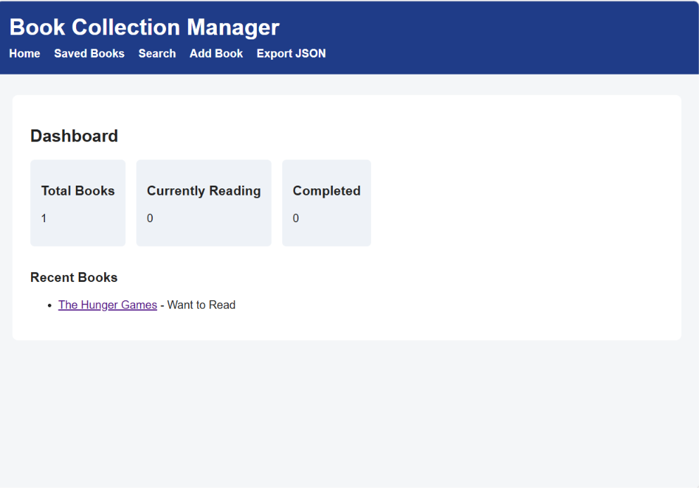
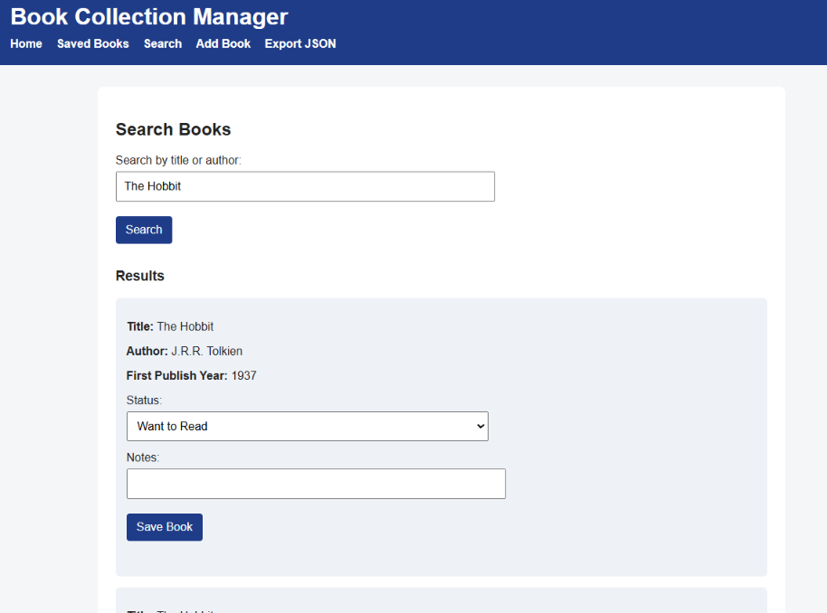
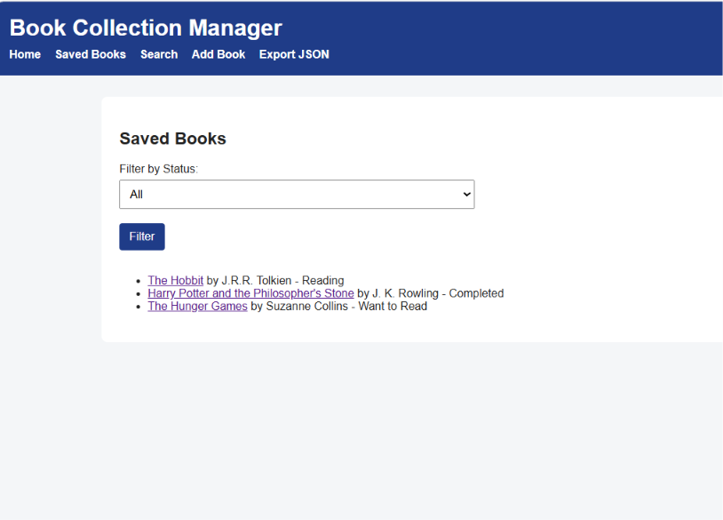
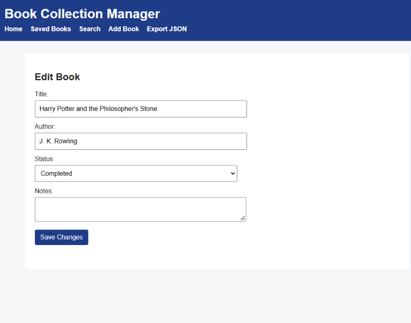

# Book Collection Manager

A Python Flask web application for searching, organizing, and tracking personal book collections.

## Application Screenshots

### Dashboard

### Book Search

### Saved Books

### Edit Book

## Features

- Search for books using the Open Library API
- Save books to a personal collection
- Add books manually
- Edit book titles, authors, reading status, and notes
- Delete books from the collection
- Filter books by reading status
- View reading statistics on a dashboard
- Refresh book information from the API
- Export saved book information as JSON
- Store book records locally using SQLite

## Technologies Used

- Python
- Flask
- SQLite
- HTML
- CSS
- JavaScript
- Open Library API
- Git and GitHub

## Project Background

This application was developed as a college capstone project.

The project provided hands-on experience working with external APIs, managing data in a database, creating web application routes, and connecting frontend pages with backend functionality.

AI tools were also used as part of the learning and development process, with an emphasis on understanding the code and how the different components work together.

## Current Status

Completed academic project. Core features have been tested locally.

## Future Improvements

- Improve the user interface
- Add more advanced searching and filtering
- Improve error handling
- Add automated tests

## How to Run the Application

### Requirements
- Python 3
- Git

### Installation

1. Clone the repository:

   git clone https://github.com/Jess3579/flask-book-tracker.git

2. Open the project folder:

   cd flask-book-tracker

3. Create a virtual environment:

   python -m venv .venv

4. Activate it in Windows PowerShell:

   .\.venv\Scripts\Activate.ps1

5. Install the dependencies:

   python -m pip install -r requirements.txt

6. Create your local configuration file:

   Copy config.example.json to config.json.

   In Windows PowerShell, run:

   Copy-Item config.example.json config.json

7. Set a Flask secret key in PowerShell:

   $env:SECRET_KEY = (python -c "import secrets; print(secrets.token_hex(32))")

8. Run the application:

   python -m flask --app jdoodle run

9. Open http://127.0.0.1:5000 in your browser.

### Notes
- The application uses SQLite for local book storage.
- The database file and private configuration are not included in the repository.
- Keep the generated secret key private.
- The application is intended for local development and demonstration.

